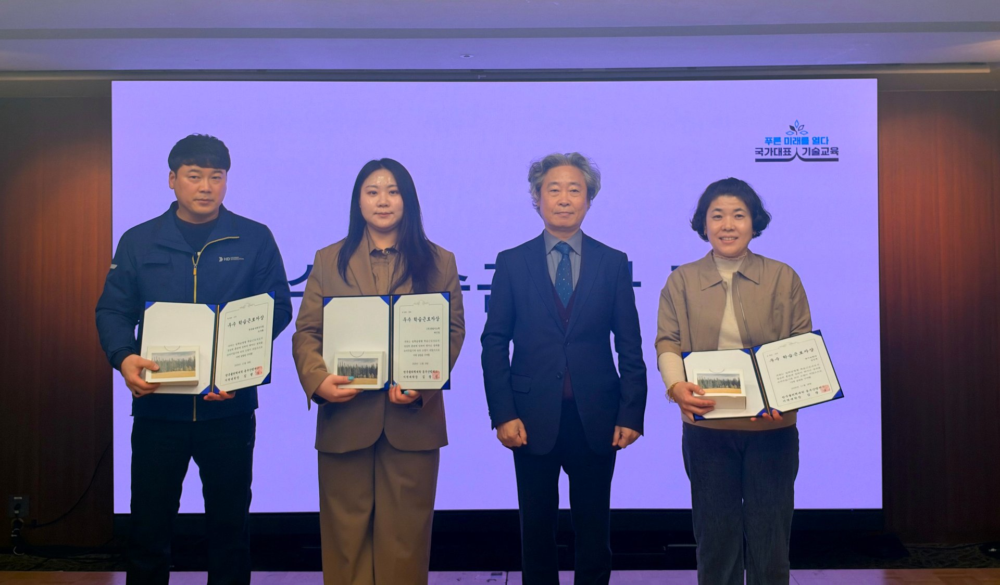
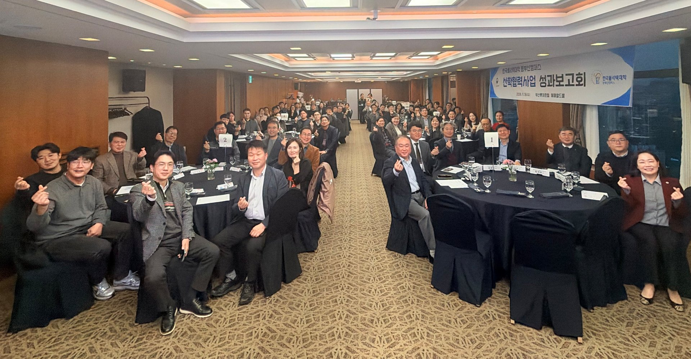

한국폴리텍대학 동부산캠퍼스에서 개최된 ‘산학협력사업 성과보고회’에서 당사 박O영 선임님이 ‘우수 학습근로자 표창’을 수상하는 뜻깊은 성과를 거두었습니다.

일학습병행제는 기업 현장의 실무 훈련과 대학의 이론 교육을 병행해 핵심 인재를 육성하는 국가 주도 교육훈련 제도입니다. 이번 표창은 업무와 학습을 성실히 병행하며 뛰어난 직무 역량을 보여준 노력의 결실입니다.

바쁜 업무 속에서도 값진 결과를 이끌어낸 박O영 선임님께 진심으로 축하를 전합니다. 앞으로도 체계적인 교육 지원과 산학협력을 통해 임직원과 함께 성장해 나가겠습니다.

